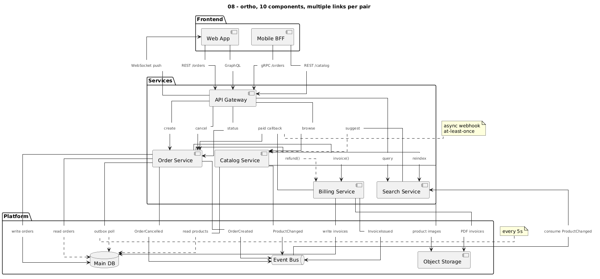

# PlantUML Tricks: readable labels with `linetype ortho`

`skinparam linetype ortho` gives clean right-angle lines, but link labels and link
notes become hard to control: they float, overlap, and ignore every attempt to move
them. This repo collects what actually works, with rendered examples.



## TL;DR

Graphviz cannot attach labels to ortho edges, so PlantUML turns them into floating
"xlabels" that you cannot position. **Make each label a small borderless node in the
middle of its link instead.** Ortho then routes around it, parallel links stay apart,
and you can position labels and notes like any other element.

```plantuml
skinparam linetype ortho

skinparam rectangle<<lbl>> {
  BorderColor transparent
  BackgroundColor transparent
  FontSize 10
  FontColor #444444
}
hide <<lbl>> stereotype

!procedure $lbl($id, $text)
  rectangle "$text" <<lbl>> as $id
!endprocedure
!procedure $via($a, $id, $b, $dir="down", $arr="-->")
  $a -$dir- $id
  $id $arr $b
!endprocedure

[Order Service] as order
[Payment Service] as pay

$lbl(l_charge, "charge(order)")
$via(order, l_charge, pay, "right")
note right of l_charge : retries: 3
```

The helpers are also in [`lib/label-nodes.iuml`](lib/label-nodes.iuml).

## Docs

| Doc | Content |
|---|---|
| [01 – Why ortho labels misbehave](docs/01-why-ortho-labels-fail.md) | The root cause, and the baseline problem |
| [02 – The label-node technique](docs/02-label-nodes.md) | How it works, the helpers, how to position labels and notes |
| [03 – Readability tricks](docs/03-readability-tricks.md) | Everything else that makes big ortho diagrams readable |
| [04 – What did not work](docs/04-what-didnt-work.md) | Spacing, padding, native link notes, other layout engines |
| [05 – Ports](docs/05-ports.md) | Separate attachment points per link, invisible ports, port names as pinned labels |
| [06 – Numbered labels](docs/06-numbered-labels.md) | Short native labels + legend table, the quickest fix |
| [07 – Mermaid alternative](docs/07-mermaid.md) | Mermaid + ELK: right-angle lines with native labels |

## Examples

All in [`examples/`](examples), each `.puml` / `.mmd` has its rendered `.png` next to it.

| File | Shows |
|---|---|
| `01_baseline_ortho` | Complex component diagram, ortho, default labels: overlaps |
| `02_spacing` | Only more `nodesep`/`ranksep`: still collides |
| `03_smetana` | `!pragma layout smetana`: labels fine, but ortho ignored |
| `03_elk` | `!pragma layout elk`: needs ELK on the server (crashed on the test server) |
| `04_label_nodes` | Label nodes, first attempt (labels declared outside packages) |
| `05_label_nodes_refined` | Label nodes declared inside packages, notes on labels |
| `06_native_tricks` | Native knobs (padding, `note … on link`, head/tail labels) under ortho |
| `07_polyline` | `linetype polyline` as the low-effort alternative |
| `08_ortho_multi_links` | 10 components, ~30 links, many parallel links per pair |
| `09_ports` | Visible ports: one attachment point per link |
| `10_ports_invisible` | Invisible ports, port names as labels pinned to the endpoints |
| `11_numbered_labels` | Same diagram as 08 with numbered labels and a legend |
| `12_mermaid` | Same diagram in Mermaid with ELK layout (`.mmd`) |

## Rendering

```bash
./render.sh examples/08_ortho_multi_links.puml        # png
./render.sh examples/08_ortho_multi_links.puml svg
PLANTUML_SERVER=http://myhost:8080 ./render.sh file.puml
```

The Mermaid example is rendered with Mermaid 11 + `@mermaid-js/layout-elk` (e.g. in a
browser or with `mermaid-cli`).

Tested with PlantUML 1.2026.9 and Graphviz 14.0.1. A PlantUML server cannot resolve
local `!include` files, so every example is self-contained.
