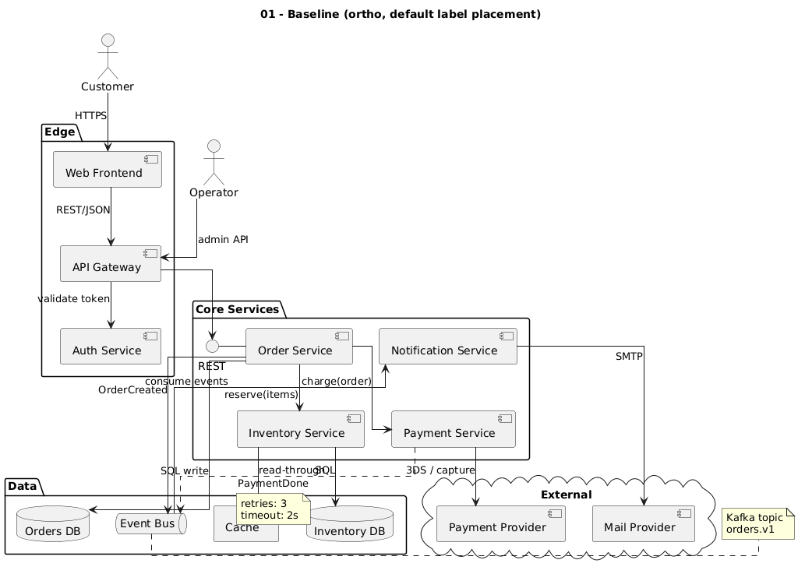

# 01 – Why ortho labels misbehave

PlantUML hands layout to Graphviz `dot`. With `skinparam linetype ortho` it uses
`splines=ortho`, and Graphviz's ortho router **does not support edge labels**.
PlantUML works around that by emitting the labels as `xlabel`s: free-floating text
that Graphviz places *after* routing, wherever it finds room.

Consequences:

- Labels are not tied to their line. They often sit next to a *different* line.
- Labels overlap each other and other lines (`read-throughSQL` below).
- `note on link` is placed the same loose way and can cover components.
- Parallel links between the same two components get merged into one route,
  so you cannot tell them apart.
- None of the usual knobs (padding, newlines, spacing) move an xlabel reliably.

## Baseline

[`examples/01_baseline_ortho.puml`](../examples/01_baseline_ortho.puml)

Look at "read-through" / "SQL" under Inventory Service, "consume events" sitting on
"OrderCreated", and the `retries / timeout` note on top of Cache.

Next: [02 – The label-node technique](02-label-nodes.md)
