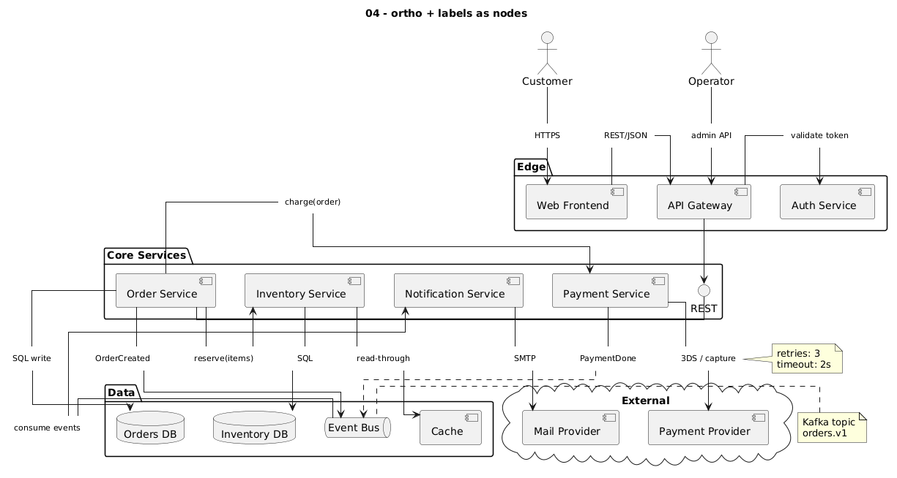
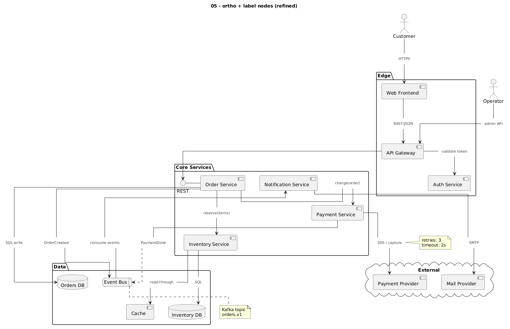

# 02 – The label-node technique

Replace every labeled link `a --> b : text` with two links through a small,
invisible node that carries the text:

```
a ── [text] ──> b
```

Because the label is now a real node:

- ortho routes **around** it, so labels never overlap lines or each other
- parallel links each get their own label node, so they get **separate routes**
- you position the label with normal layout tools (direction, length, order)
- notes attach to the label node, so they land **exactly** where you want

## Helpers

From [`lib/label-nodes.iuml`](../lib/label-nodes.iuml):

```plantuml
skinparam rectangle<<lbl>> {
  BorderColor transparent
  BackgroundColor transparent
  FontSize 10
  FontColor #444444
  Shadow false
}
hide <<lbl>> stereotype

' declare a label node
!procedure $lbl($id, $text)
  rectangle "$text" <<lbl>> as $id
!endprocedure

' route a -> label -> b ; $dir positions the label relative to a
!procedure $via($a, $id, $b, $dir="down", $arr="-->")
  $a -$dir- $id
  $id $arr $b
!endprocedure
```

Usage:

```plantuml
$lbl(l_charge, "charge(order)")
$via(order, l_charge, pay, "right")           ' solid arrow, label right of order
$via(order, l_refund, bill, "right", "..>")   ' dashed arrow
```

## Rule 1: declare label nodes in the right package

This is the single most important detail. A label node declared at top level is
*outside* every package, so Graphviz drags the link out of its container.

| Link | Declare the label… |
|---|---|
| both ends in the same package | inside that package |
| crosses packages | inside the **target** package (sits right above the target) |
| actor → package, or between top-level elements | at top level |

First attempt, all labels at top level ([`04_label_nodes`](../examples/04_label_nodes.puml)).
`charge(order)` floats above everything and all labels end up in one row:



Labels declared inside their packages ([`05_label_nodes_refined`](../examples/05_label_nodes_refined.puml)):



In the 10-component example this rule alone cut the width roughly in half.

## Rule 2: position with direction and length

- `$via(a, l, b, "right")`: the label sits to the right of `a`. Also `left`, `up`, `down`.
- Use `---` instead of `--` inside the procedure (or a second variant) for more distance.
- **Back edges** (target is above the source, e.g. Event Bus → Notification Service):
  - `-up-` keeps the label next to its line (may add a crossing)
  - `-[norank]-` avoids distorting the layers but can cause long detours
  - try both

```plantuml
' back edge
bus -up- l_consume
l_consume -up-> notif
```

## Rule 3: notes go on the label node

```plantuml
note right of l_3ds
  retries: 3
  timeout: 2s
end note
```

`note on link` does not work reliably under ortho (see [04](04-what-didnt-work.md)).
`note left|right|top|bottom of <label id>` does.

## Many parallel links

[`08_ortho_multi_links`](../examples/08_ortho_multi_links.puml): 10 components,
~30 links, up to 3 links between the same pair, in both directions.


Each parallel link has its own label node, so each gets its own route.

## Costs

- Labels take space, so diagrams get larger.
- More source code per link (the helpers keep it to 2 lines).
- Graphviz still decides the final layout. Some crossings remain; see
  [03 – Readability tricks](03-readability-tricks.md) for reducing them.
