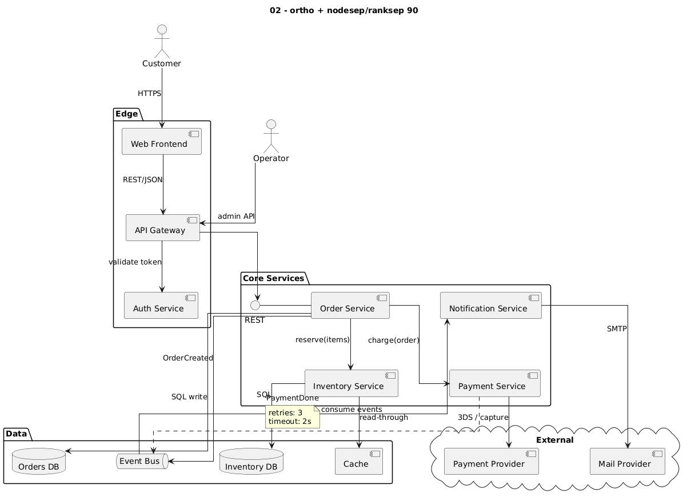
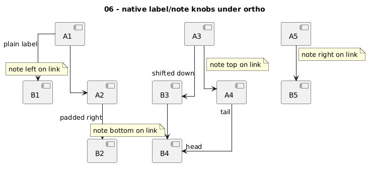
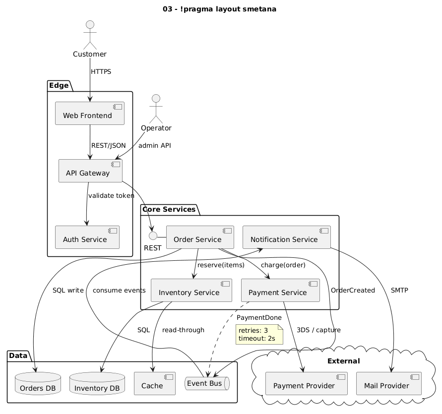
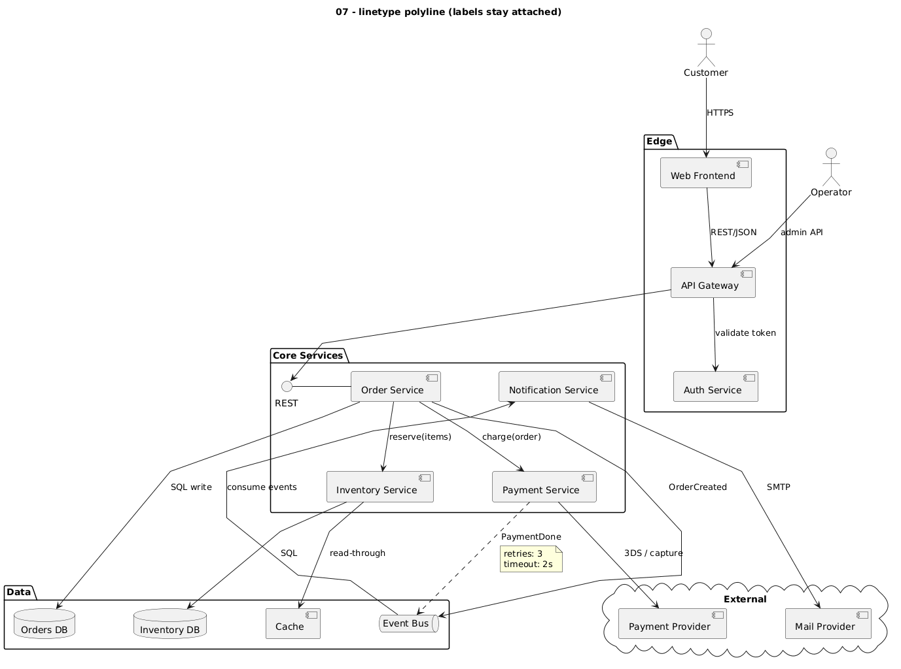

# 04 – What did not work

Tested with PlantUML 1.2026.9 / Graphviz 14.0.1, so you don't have to.

## More spacing

[`02_spacing`](../examples/02_spacing.puml): `skinparam nodesep 90` / `ranksep 90`.
Labels get more room but still float and collide ("SQL" on "PaymentDone").

## Padding, newlines, native link notes

[`06_native_tricks`](../examples/06_native_tricks.puml)

| Trick | Result under ortho |
|---|---|
| leading non-breaking spaces `<U+00A0>…` | no visible shift |
| leading `\n\n\n` | label not moved down |
| `a "tail" --> "head" b` | placed near the ends, but loosely |
| `note left/right/top/bottom on link` | placed loosely; can land on the wrong link |

## Other layout engines

- **`!pragma layout smetana`** ([`03_smetana`](../examples/03_smetana.puml)): labels
  are attached properly, but ortho is ignored and lines are curved.

  

- **`!pragma layout elk`** ([`03_elk`](../examples/03_elk.puml)): needs the ELK
  libraries on the server; crashed on the test server. Worth trying if your
  installation has them.

## The low-effort alternative: polyline

[`07_polyline`](../examples/07_polyline.puml): `skinparam linetype polyline` keeps
labels attached to their lines. Lines are angled instead of right-angled. If you
don't strictly need ortho, this is by far the least work.

