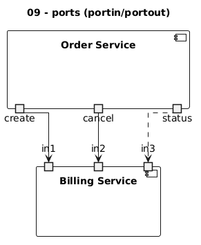
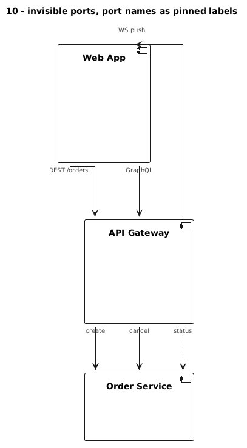

# 05 – Ports: separate attachment points (and pinned labels)

Component diagrams support ports. Every link attached to a port leaves or enters
the component at **its own point on the edge**, so parallel links never share an
endpoint.

```plantuml
component "Order Service" as order {
  portout "create" as o_create
  portout "cancel" as o_cancel
}
component "Billing Service" as bill {
  portin "in1" as b_in1
  portin "in2" as b_in2
}
o_create --> b_in1
o_cancel --> b_in2
```

- `portin` is placed on the top edge, `portout` on the bottom edge (top-down layout)
- plain `port` lets Graphviz pick the side, which is useful for back edges (see below)
- the port name is drawn next to the port

[`09_ports`](../examples/09_ports.puml):



## Invisible ports

Yes, ports can be invisible, but only with a `<style>` block. These `skinparam`
variants were tested and have **no effect** on ports:
`skinparam portBorderColor/portBackgroundColor/portFontColor` and
`skinparam port<<stereo>> { … }`.

```plantuml
<style>
port {
  LineColor transparent
  BackGroundColor transparent
}
</style>
```

## Port names as pinned labels

If you keep the port's font visible, the port name becomes a label that sits
**exactly where the link leaves or enters the component**, even under ortho.
Hide the names you don't need with a stereotype class:

```plantuml
<style>
port {
  LineColor transparent
  BackGroundColor transparent
  FontSize 10
  FontColor #444444
}
.inv {
  FontColor transparent
}
</style>
hide <<inv>> stereotype

component "API Gateway" as gw {
  portin "in" as g_in1 <<inv>>     ' fully invisible
  portout "create" as g1           ' visible label "create" at the exit point
}
```

[`10_ports_invisible`](../examples/10_ports_invisible.puml):



### Back edges

A link from a `portout` (bottom edge) back **up** to a component above runs
straight through both boxes. Declare both ends as plain `port` and use `-up->`:

```plantuml
component "Web App" as web {
  port "WS push" as w3
}
component "API Gateway" as gw {
  port "out" as g_out <<inv>>
}
g_out -up-> w3
```

## Trade-offs

- Components with ports are drawn as tall boxes.
- Every port needs an id, so the source code gets more verbose.
- Labels are pinned to the endpoint, not the middle of the line. That's good
  for "what goes out/in here", less good for long descriptions.
- Combines well with label nodes ([02](02-label-nodes.md)): ports separate the
  endpoints, label nodes carry the text.
