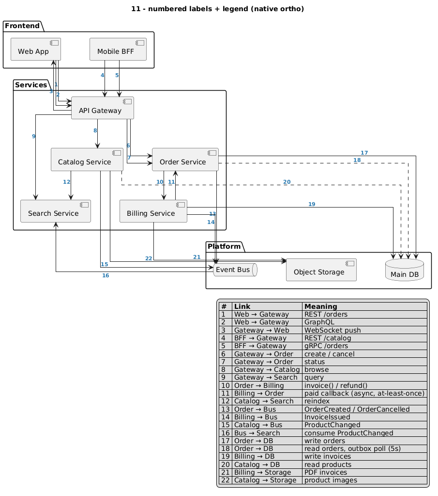

# 06 – Numbered labels + legend

The least invasive option: keep native ortho labels, but make them **short**.
Put a number on each link and explain it in a legend table.

Short xlabels rarely collide, parallel links stay distinguishable, and the long
text moves to a place where it cannot overlap anything.

```plantuml
skinparam linetype ortho
skinparam ArrowFontSize 11
skinparam ArrowFontStyle bold
skinparam ArrowFontColor #2a7ab0

web --> gw : 1
web --> gw : 2

legend right
  |= # |= Link |= Meaning |
  | 1 | Web → Gateway | REST /orders |
  | 2 | Web → Gateway | GraphQL |
endlegend
```

[`11_numbered_labels`](../examples/11_numbered_labels.puml): the same 10
components and 22 links as example 08, with no helper nodes:



## Notes

- A bold, coloured label font makes the numbers easy to spot and separates them
  from component names.
- Numbers are still floating xlabels: in very dense spots (1/2/3 and 13/14 above)
  they sit close together, but they stay readable.
- When sending the source to a PlantUML server, send it as UTF-8
  (`Content-Type: text/plain; charset=utf-8`), otherwise characters like `→`
  in the legend break. `render.sh` does this.
- Works with any diagram type and needs no restructuring, so it's the quickest
  fix for an existing diagram.
