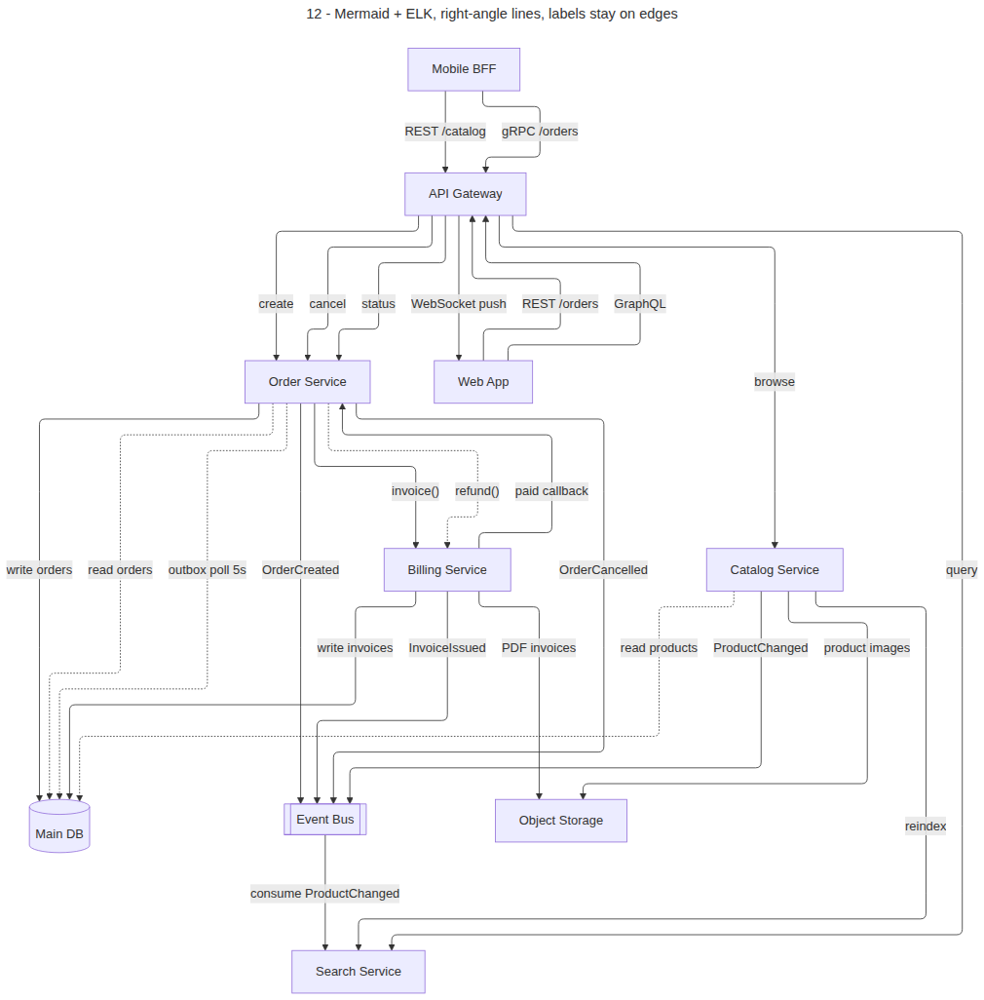
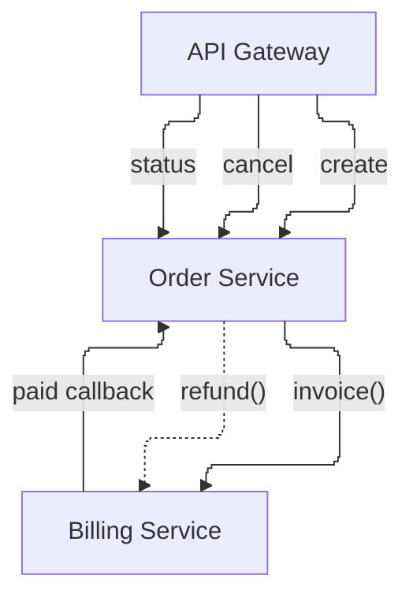

# 07 – Mermaid alternative

Mermaid flowcharts with the **ELK** layout give right-angle lines **and** labels
that stay on their lines. No workaround is needed for the labels themselves.

[`12_mermaid.mmd`](../examples/12_mermaid.mmd): the same 10 components and
26 links as example 08:





## Findings

| Variant | Result |
|---|---|
| ELK, **no subgraphs** | Clean right-angle lines, labels on their lines, parallel links separated (image above) |
| ELK + subgraphs | Links between subgraphs take long detours; Frontend ended up at the bottom |
| dagre (default) + `curve: step` + subgraphs | Top part fine, but Platform pushed sideways; `~~~` invisible links didn't fix it |
| dagre, no subgraphs | Usable, but ELK is clearly better |

So: **use ELK and avoid subgraphs** for dense diagrams. Group with `%%` comments
and declaration order instead, or use colours via `classDef`.

## Requirements

- `layout: elk` needs the `@mermaid-js/layout-elk` package registered:

  ```js
  import mermaid from 'mermaid';
  import elkLayouts from '@mermaid-js/layout-elk';
  mermaid.registerLayoutLoaders(elkLayouts);
  ```

- Where the renderer doesn't support ELK, Mermaid falls back to dagre and you
  get the "dagre, no subgraphs" result. Check your target (GitHub, GitLab, your
  docs tool) before relying on ELK.
- Labels with parentheses need quotes: `|"invoice()"|`.

## PlantUML vs Mermaid

| | PlantUML ortho + label nodes | Mermaid + ELK |
|---|---|---|
| Right-angle lines | yes | yes |
| Labels attached | via workaround | native |
| Packages / grouping | yes, works well | subgraphs hurt the layout |
| UML notation (components, ports, interfaces) | full | flowchart shapes only |
| Renders on GitHub | as an image | natively (ELK support depends on renderer) |
